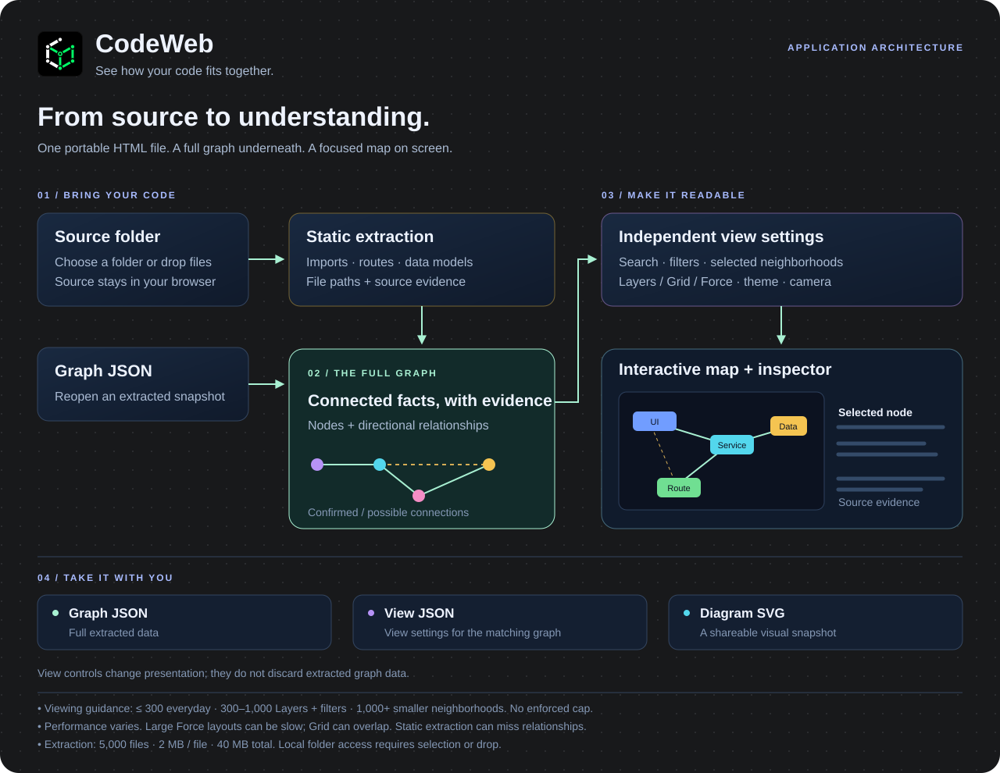

# CodeWeb


Turn a source folder into an interactive map of files, dependencies, routes, and data models. Explore connections and inspect the source evidence behind them, all in your browser.

## Get started

[Open CodeWeb in your browser](https://4raisan.github.io/CodeWeb/), or download a copy for offline use.

1. Download **CodeWeb.html** from [Releases](https://github.com/4Raisan/CodeWeb/releases/latest).
2. Open it in your browser.
3. Choose **Open project → Project folder**, drop files, or open a graph JSON export.

One HTML file. No installation. Local folder access requires your selection or drop; imported source code is never executed.

**Try a sample:** Download the [sample graph JSON](https://raw.githubusercontent.com/4Raisan/CodeWeb/main/docs/sample-graph.json), then select **Open project → JSON file** in CodeWeb.

## Explore and save

- Search for files, endpoints, and models. Select a node to see its connections and evidence.
- Use **Show neighbors** and node-type filters to focus the map.
- Choose Architecture layers, Grid, or Force; adjust spacing, themes, and connections.
- Export **SVG** for a diagram, **graph JSON** for the extracted data, or **view JSON** for settings to restore against the matching graph.
- The update dot beside **Star on GitHub** checks GitHub on launch: green means current, gray means unavailable/offline, and glowing red with **Get latest** means an update exists. Click the dot to recheck. No project data is sent.



## Practical limits

Aim for **up to 300 visible nodes** for everyday use. For 300–1,000, prefer Layers and filters; above 1,000, explore neighborhoods. This is guidance, not a cap or performance guarantee. Large Force layouts can be slow and Grid can overlap.

Static extraction can miss dynamic relationships or framework routes. Imports outside the chosen folder remain unresolved. Extraction limits: **5,000 files · 2 MB per file · 40 MB total**. See [validation notes](docs/QA.md) and [measured performance comparisons](docs/PERFORMANCE.md).

## Development

Requires Node.js 22 or later. No dependencies need installing.

```sh
npm --prefix app run serve
npm --prefix app run lint
npm --prefix app run check
npm --prefix app test
npm --prefix app run build:standalone
```

Open the development preview at `http://127.0.0.1:8000`. Edit `app/`, then rebuild `release/CodeWeb.html`. [Contribution guide](CONTRIBUTING.md) · [Security](SECURITY.md) · [MIT license](LICENSE)
